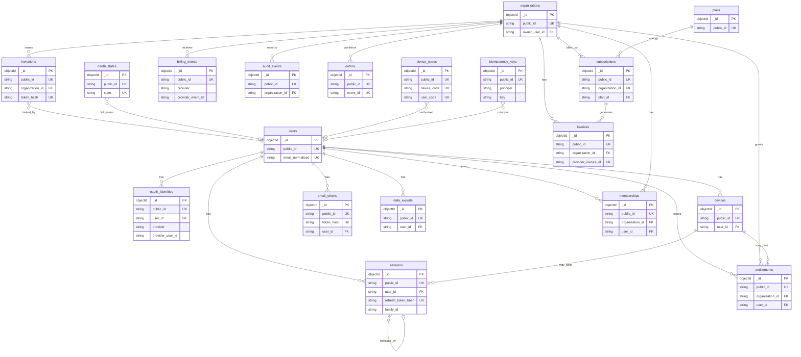

# Cabinet Studio MongoDB Schema v1

**Document role:** Canonical MongoDB document model for the Cabinet Studio commercial backend  
**Audience:** Go + Gin implementers, QA, Atlas operators  
**API twin:** [`API_CONTRACTS_V1.md`](./API_CONTRACTS_V1.md) (64 unique method+path pairs) and [`openapi-v1.yaml`](./openapi-v1.yaml)  
**Database:** `cabinet_studio`  
**Collections:** 19 (no extras in v1)  
**Baseline date:** 2026-09-01  
**Status:** Approved schema for implementation; not evidence that collections are deployed  

Machine-readable companion: [`schema-v1.json`](./schema-v1.json).

---

## 0. Front matter

| Item | Value |
| --- | --- |
| Engine | MongoDB Atlas (replica set required for multi-document transactions) |
| Database name | `cabinet_studio` |
| Relational store | None. No Postgres. |
| Internal primary key | `_id` BSON `ObjectId` (never returned on the public API) |
| Public primary key | `public_id` opaque prefixed string, unique per collection |
| Timestamps | BSON `Date`, always UTC. JSON wire format is ISO-8601 with `Z` |
| Field names | `snake_case` (BSON and API) |
| Tenant isolation field | `organization_id` = organizations.`public_id` (`org_…`) |
| Referential integrity | Application-enforced (existence checks + transactions). MongoDB does not enforce FKs. |
| Password hash | argon2id PHC string. Never plaintext. |
| Token hash | SHA-256 of `pepper \|\| raw_token` (hex). Never raw tokens. |
| Access tokens | Signed JWT; **not stored** in MongoDB |
| Kafka | Downstream of `outbox`. Kafka is **not** the source of truth. |

This schema is the persistence counterpart of the 64-route HTTP contract. Handlers commit application documents and an outbox row in the same Mongo transaction; a worker publishes to Kafka after commit (`API_CONTRACTS_V1.md` §1.5).

---

## 1. Global conventions

### 1.1 Public IDs

Generate 128 bits of CSPRNG (or ULID) and encode Crockford-base32 / lowercase hex, then prefix. Sequential `ObjectId` hex must never appear in API responses, logs that leave the security boundary, or Kafka payloads that clients can see.

| Prefix | Collection | Typical API exposure |
| --- | --- | --- |
| `usr_` | `users` | yes (`id`) |
| `oid_` | `oauth_identities` | no (addressed by `provider`) |
| `org_` | `organizations` | yes |
| `mbr_` | `memberships` | no (paths use `userId`) |
| `inv_` | `invitations` | yes |
| `dev_` | `devices` | yes |
| `ses_` | `sessions` | yes |
| `tok_` | `email_tokens` | no (raw token uses `ev_` / `pr_` / `ec_`) |
| `st_` | `oauth_states` | yes (`state`) |
| `dc_` | `device_codes` | yes (`device_code`) |
| `plan_` | `plans` | yes |
| `sub_` | `subscriptions` | yes |
| `invc_` | `invoices` | yes |
| `bev_` | `billing_events` | no |
| `ent_` | `entitlements` | no (snapshot is returned without this id) |
| `evt_` | `audit_events` | yes |
| `obx_` | `outbox` | no |
| `idk_` | `idempotency_keys` | no |
| `exp_` | `data_exports` | yes (`export_id`) |

`oid_` is the only prefix not listed in the original ID-prefix set; it exists so every collection still has a unique `public_id`. The HTTP contract never returns it.

Raw one-time secrets (never persisted):

| Prefix | Secret | Stored as |
| --- | --- | --- |
| `ev_` | email verification token | `email_tokens.token_hash` |
| `pr_` | password-reset token | `email_tokens.token_hash` |
| `ec_` | email-change token | `email_tokens.token_hash` |
| `rt_` | refresh token | `sessions.refresh_token_hash` |
| (email link) | invitation token | `invitations.token_hash` |

### 1.2 Tenant vs user-owned

Every document that belongs to a cabinet business **must** include `organization_id` (`org_…` string).

**Tenant-scoped (always have `organization_id`):**  
`organizations` (self id), `memberships`, `invitations`, `subscriptions`, `invoices`, `billing_events`, `entitlements` (nullable only when the user has no org yet), `audit_events`, `outbox` (partition key is usually org).

**User-owned / global (no required `organization_id`):**  
`users`, `oauth_identities`, `devices`, `sessions`, `email_tokens`, `oauth_states`, `device_codes`, `data_exports`, `idempotency_keys`, `plans`.

`idempotency_keys.principal` is `usr_…` when authenticated, else `ip:<sha256>` plus route for public auth.

### 1.3 BSON / JSON mapping

| Logical type | BSON | JSON in samples below |
| --- | --- | --- |
| ObjectId | `objectId` | `"$oid"` in samples; stored as ObjectId |
| Instant | `date` | `"2026-09-01T00:00:00Z"` (UTC) |
| Enum | `string` | string |
| Money | `int` / `long` minor units | integer cents |
| Hash | `string` | `"sha256:…"` or PHC |
| Map | `object` | object |
| Null | `null` | `null` |

Indexes are specified as MongoDB `createIndexes` key documents plus options. All unique `public_id` indexes are named `uniq_public_id`.

### 1.4 Soft delete and status

Do not physically delete tenant rows in v1 except TTL collections. Use status/state fields (`removed`, `deleted`, `revoked`, `deactivated`). `DELETE` HTTP routes are logical.

### 1.5 Hashing

| Secret | Algorithm | Notes |
| --- | --- | --- |
| Password | argon2id (`m=65536,t=3,p=4`, PHC) | Nullable if OAuth-only |
| Refresh / invite / email / device secrets | SHA-256(`pepper \|\| raw`) hex | Pepper in KMS / env, not in Mongo |
| Idempotency body | SHA-256 of canonical JSON | Detect key reuse with different body |

Never log raw secrets. Never store provider OAuth access/refresh tokens.

---

## 2. ER diagram



---

## 3. Collections

### 3.1 `users`

**Purpose.** Human identity, credentials, legal acceptance, and account lifecycle. One row per person. Not tenant-scoped.

**PK.** `_id` ObjectId + `public_id` unique (`usr_`).

#### Fields

| Name | BSON | Required | Default | Notes |
| --- | --- | --- | --- | --- |
| `_id` | objectId | yes | auto | Internal only |
| `public_id` | string | yes | generated `usr_` | API `user.id` |
| `email` | string | yes | — | Lowercase display email, max 254 |
| `email_normalized` | string | yes | `lower(trim(email))` | Unique lookup key |
| `email_verified_at` | date \| null | no | `null` | Null ⇒ API `email_verified=false` |
| `password_hash` | string \| null | no | `null` | argon2id PHC; null if OAuth-only. Never plaintext |
| `password_updated_at` | date \| null | no | `null` | Set on set/change/reset |
| `display_name` | string | yes | — | 1–80 chars |
| `terms_version` | string | yes | — | Must match public config at accept time |
| `privacy_version` | string | yes | — | Must match public config at accept time |
| `terms_accepted_at` | date | yes | now | Legal acceptance instant |
| `pending_email` | string \| null | no | `null` | Target of in-flight email change (normalized) |
| `status` | string | yes | `"active"` | `active` \| `disabled` \| `pending_deletion` |
| `disabled_at` | date \| null | no | `null` | When `status=disabled` |
| `deletion_requested_at` | date \| null | no | `null` | Account deletion request; org ownership must be clear |
| `last_login_at` | date \| null | no | `null` | Last successful login/oauth/device-token |
| `created_at` | date | yes | now | UTC |
| `updated_at` | date | yes | now | UTC |

`disabled` maps to HTTP `403 account_suspended`. Cloud sharing and billing still require `email_verified_at != null` (`AUT-001`).

#### Foreign keys

None outbound. Referenced by user-owned collections via `user_id` → `users.public_id`.

#### Unique indexes

```json
{ "keys": { "public_id": 1 }, "options": { "unique": true, "name": "uniq_public_id" } }
{ "keys": { "email_normalized": 1 }, "options": { "unique": true, "name": "uniq_email_normalized" } }
```

#### Secondary indexes

```json
{ "keys": { "status": 1, "created_at": -1 }, "options": { "name": "idx_status_created_at" } }
{ "keys": { "pending_email": 1 }, "options": { "name": "idx_pending_email", "sparse": true } }
```

#### Shard key (later)

`{ "public_id": "hashed" }` — user-owned collection.

#### Sample document

```json
{
  "_id": { "$oid": "68b4c8a01f2a4d6e8b0c1234" },
  "public_id": "usr_ada01f3e8c2b4a90",
  "email": "ada@example.com",
  "email_normalized": "ada@example.com",
  "email_verified_at": "2026-08-01T10:12:00Z",
  "password_hash": "$argon2id$v=19$m=65536,t=3,p=4$REDACTED_SALT$REDACTED_HASH",
  "password_updated_at": "2026-08-01T10:00:00Z",
  "display_name": "Ada Lovelace",
  "terms_version": "2026-06-01",
  "privacy_version": "2026-06-01",
  "terms_accepted_at": "2026-08-01T10:00:00Z",
  "pending_email": null,
  "status": "active",
  "disabled_at": null,
  "deletion_requested_at": null,
  "last_login_at": "2026-09-01T00:00:00Z",
  "created_at": "2026-08-01T10:00:00Z",
  "updated_at": "2026-09-01T00:00:00Z"
}
```

#### API routes

| Op | Routes |
| --- | --- |
| W | `POST /v1/auth/register`, `POST /v1/auth/verify-email`, `POST /v1/auth/password-reset/confirm`, `PATCH /v1/me`, `POST /v1/me/password`, `POST /v1/me/email/change`, `POST /v1/me/email/change/confirm`, `GET /v1/auth/oauth/{provider}/callback` (create on first login), `POST /v1/auth/device/token` (touch `last_login_at`) |
| R | `GET /v1/me`, login/refresh/oauth success bodies, member directory projections, invitation preview (`inviter_display_name`) |
| Auth lookup | `POST /v1/auth/login`, `POST /v1/auth/resend-verification`, `POST /v1/auth/password-reset` (existence-oracle safe) |

---

### 3.2 `oauth_identities`

**Purpose.** Links a Cabinet Studio user to one social/SSO subject per provider (`google` \| `facebook` \| `x`). Stores no provider tokens.

**PK.** `_id` + `public_id` unique (`oid_`).

#### Fields

| Name | BSON | Required | Default | Notes |
| --- | --- | --- | --- | --- |
| `_id` | objectId | yes | auto | Internal |
| `public_id` | string | yes | `oid_` | Not returned by API |
| `user_id` | string | yes | — | → `users.public_id` |
| `provider` | string | yes | — | `google` \| `facebook` \| `x` |
| `provider_user_id` | string | yes | — | Provider subject; not a secret |
| `email` | string \| null | no | `null` | Email asserted by provider (normalized) |
| `email_verified_by_provider` | bool | yes | `false` | Used when creating a new user on login intent |
| `linked_at` | date | yes | now | UTC |
| `updated_at` | date | yes | now | UTC |
| `created_at` | date | yes | now | UTC |

Unlink refuses if it would leave the user with neither `password_hash` nor another identity.

#### Foreign keys

| Field | References |
| --- | --- |
| `user_id` | `users.public_id` |

#### Unique indexes

```json
{ "keys": { "public_id": 1 }, "options": { "unique": true, "name": "uniq_public_id" } }
{ "keys": { "provider": 1, "provider_user_id": 1 }, "options": { "unique": true, "name": "uniq_provider_subject" } }
{ "keys": { "user_id": 1, "provider": 1 }, "options": { "unique": true, "name": "uniq_user_provider" } }
```

#### Secondary indexes

None required. The two compound uniques cover list-by-user and login-by-subject.

#### Shard key (later)

`{ "user_id": "hashed" }`.

#### Sample document

```json
{
  "_id": { "$oid": "68b4c8a01f2a4d6e8b0c2001" },
  "public_id": "oid_gada01c9e4b7a210",
  "user_id": "usr_ada01f3e8c2b4a90",
  "provider": "google",
  "provider_user_id": "gid_opaque",
  "email": "ada@example.com",
  "email_verified_by_provider": true,
  "linked_at": "2026-08-12T09:00:00Z",
  "created_at": "2026-08-12T09:00:00Z",
  "updated_at": "2026-08-12T09:00:00Z"
}
```

#### API routes

| Op | Routes |
| --- | --- |
| R | `GET /v1/me/identities` |
| W | `GET /v1/auth/oauth/{provider}/callback` (login upsert), `POST /v1/me/identities/{provider}/link`, `DELETE /v1/me/identities/{provider}`, `POST /v1/auth/device/token` |

---

### 3.3 `organizations`

**Purpose.** Cabinet business, billing boundary, and shared-data owner. Trial clock starts at create (`trial_ends_at` = `created_at + 14d`).

**PK.** `_id` + `public_id` unique (`org_`). `organization_id` on other collections equals this `public_id`.

#### Fields

| Name | BSON | Required | Default | Notes |
| --- | --- | --- | --- | --- |
| `_id` | objectId | yes | auto | Internal |
| `public_id` | string | yes | `org_` | API `organization.id`; tenant key |
| `name` | string | yes | — | 1–120 chars |
| `owner_user_id` | string | yes | — | → `users.public_id`; denormalized from membership role=owner |
| `status` | string | yes | `"active"` | `active` \| `pending_deletion` \| `deleted` |
| `trial_ends_at` | date \| null | no | create+14d | Kept after conversion for history |
| `provider` | string \| null | no | `null` | `stripe` \| `fake` once a customer exists |
| `provider_customer_id` | string \| null | no | `null` | Stripe `cus_…` / fake id. **Not** a card. Unique sparse |
| `deleted_at` | date \| null | no | `null` | API treats as gone |
| `created_at` | date | yes | now | UTC |
| `updated_at` | date | yes | now | UTC |

v1 `DELETE /v1/organizations/{id}` sets `status=deleted` immediately for API purposes. Member personal accounts are not deleted. Close is blocked while a cancelable paid subscription is still `active`/`trialing`/`past_due`/`grace` (`409 active_subscription`).

#### Foreign keys

| Field | References |
| --- | --- |
| `owner_user_id` | `users.public_id` (must also be an `active` owner membership) |

#### Unique indexes

```json
{ "keys": { "public_id": 1 }, "options": { "unique": true, "name": "uniq_public_id" } }
{ "keys": { "provider_customer_id": 1 }, "options": { "unique": true, "sparse": true, "name": "uniq_provider_customer_id" } }
```

#### Secondary indexes

```json
{ "keys": { "owner_user_id": 1 }, "options": { "name": "idx_owner_user_id" } }
{ "keys": { "status": 1, "created_at": -1 }, "options": { "name": "idx_status_created_at" } }
```

#### Shard key (later)

`{ "public_id": "hashed" }`. Child collections shard on `organization_id` (same string).

#### Sample document

```json
{
  "_id": { "$oid": "68b4c8a01f2a4d6e8b0c3001" },
  "public_id": "org_studio9d2e4c6a80",
  "name": "Lovelace Cabinets",
  "owner_user_id": "usr_ada01f3e8c2b4a90",
  "status": "active",
  "trial_ends_at": "2026-09-15T00:00:00Z",
  "provider": "fake",
  "provider_customer_id": null,
  "deleted_at": null,
  "created_at": "2026-09-01T00:00:00Z",
  "updated_at": "2026-09-01T00:00:00Z"
}
```

#### API routes

| Op | Routes |
| --- | --- |
| W | `POST /v1/organizations`, `PATCH /v1/organizations/{id}`, `DELETE /v1/organizations/{id}`, `POST /v1/organizations/{id}/transfer-ownership`, checkout/webhook (customer id) |
| R | `GET /v1/organizations`, `GET /v1/organizations/{id}`, login/oauth/device-token org projection, invitation accept |

---

### 3.4 `memberships`

**Purpose.** User ↔ organization relationship with a role and lifecycle state. Unique per `(organization_id, user_id)` including `removed` rows (reuse the same document).

**PK.** `_id` + `public_id` unique (`mbr_`).

#### Fields

| Name | BSON | Required | Default | Notes |
| --- | --- | --- | --- | --- |
| `_id` | objectId | yes | auto | Internal |
| `public_id` | string | yes | `mbr_` | Not used in HTTP paths |
| `organization_id` | string | yes | — | → `organizations.public_id` |
| `user_id` | string | yes | — | → `users.public_id` |
| `role` | string | yes | — | `owner` \| `admin` \| `billing_admin` \| `sales_designer` \| `engineer` \| `production` \| `viewer` |
| `state` | string | yes | `"active"` | `invited` \| `active` \| `suspended` \| `removed`. API field name is `status` |
| `invited_at` | date \| null | no | `null` | When state first became `invited` |
| `activated_at` | date \| null | no | now if created as owner | When first became `active` |
| `suspended_at` | date \| null | no | `null` | |
| `removed_at` | date \| null | no | `null` | |
| `created_at` | date | yes | now | UTC |
| `updated_at` | date | yes | now | UTC |

**App rules.** Last `owner` cannot leave, be removed, or be demoted (`ORG-004`, `409 last_owner`). `state=invited` is only used when the invitee already has a user id; pending email-only invites live in `invitations` until accept, which upserts `state=active`. v1: `active` members consume a seat; `suspended`/`removed`/`invited` do not. Removal does not delete org-owned projects. Role/state changes must take effect without waiting for access-token expiry (re-check membership every org-scoped request).

#### Foreign keys

| Field | References |
| --- | --- |
| `organization_id` | `organizations.public_id` |
| `user_id` | `users.public_id` |

#### Unique indexes

```json
{ "keys": { "public_id": 1 }, "options": { "unique": true, "name": "uniq_public_id" } }
{ "keys": { "organization_id": 1, "user_id": 1 }, "options": { "unique": true, "name": "uniq_org_user" } }
```

#### Secondary indexes

```json
{ "keys": { "user_id": 1, "state": 1 }, "options": { "name": "idx_user_state" } }
{ "keys": { "organization_id": 1, "state": 1, "role": 1 }, "options": { "name": "idx_org_state_role" } }
```

#### Shard key (later)

`{ "organization_id": "hashed" }`. List-my-orgs (`GET /v1/organizations`) uses `idx_user_state` (scatter-gather if sharded by org).

#### Sample document

```json
{
  "_id": { "$oid": "68b4c8a01f2a4d6e8b0c4001" },
  "public_id": "mbr_own01ada9c2e4f180",
  "organization_id": "org_studio9d2e4c6a80",
  "user_id": "usr_ada01f3e8c2b4a90",
  "role": "owner",
  "state": "active",
  "invited_at": null,
  "activated_at": "2026-09-01T00:00:00Z",
  "suspended_at": null,
  "removed_at": null,
  "created_at": "2026-09-01T00:00:00Z",
  "updated_at": "2026-09-01T00:00:00Z"
}
```

#### API routes

| Op | Routes |
| --- | --- |
| W | `POST /v1/organizations` (owner), `POST /v1/invitations/{token}/accept`, `PATCH /v1/organizations/{id}/members/{userId}`, `POST …/suspend`, `DELETE …/members/{userId}`, `POST …/leave`, `POST …/transfer-ownership` |
| R | `GET /v1/organizations/{id}/members`, `GET /v1/organizations`, every org-scoped authz check, `GET /v1/me/capabilities`, `GET /v1/organizations/{id}/seats` |

---

### 3.5 `invitations`

**Purpose.** Time-limited, single-use offer to join an organization at a non-owner role. Stores `token_hash` only.

**PK.** `_id` + `public_id` unique (`inv_`).

#### Fields

| Name | BSON | Required | Default | Notes |
| --- | --- | --- | --- | --- |
| `_id` | objectId | yes | auto | Internal |
| `public_id` | string | yes | `inv_` | API `invitation.id` |
| `organization_id` | string | yes | — | → `organizations.public_id` |
| `email` | string | yes | — | Invitee, lowercase |
| `role` | string | yes | — | Any role **except** `owner` |
| `status` | string | yes | `"pending"` | `pending` \| `accepted` \| `revoked` \| `expired` |
| `token_hash` | string | yes | — | SHA-256(pepper\|\|raw). Unique. Never raw token |
| `invited_by_user_id` | string | yes | — | → `users.public_id` |
| `expires_at` | date | yes | now+7d | Preview/accept after this ⇒ `expired` |
| `accepted_at` | date \| null | no | `null` | |
| `accepted_by_user_id` | string \| null | no | `null` | → `users.public_id` |
| `revoked_at` | date \| null | no | `null` | |
| `revoked_by_user_id` | string \| null | no | `null` | |
| `resent_at` | date \| null | no | `null` | Resend rotates `token_hash` and refreshes `expires_at` |
| `created_at` | date | yes | now | UTC |
| `updated_at` | date | yes | now | UTC |

Pending invitations count toward seat **preview**, not billed seats, until accepted. Public preview (`GET /v1/invitations/{token}`) must **not** return `organization_id`. Resend rotates the hash and does not return the new raw token.

#### Foreign keys

| Field | References |
| --- | --- |
| `organization_id` | `organizations.public_id` |
| `invited_by_user_id` | `users.public_id` |
| `accepted_by_user_id` | `users.public_id` |
| `revoked_by_user_id` | `users.public_id` |

#### Unique indexes

```json
{ "keys": { "public_id": 1 }, "options": { "unique": true, "name": "uniq_public_id" } }
{ "keys": { "token_hash": 1 }, "options": { "unique": true, "name": "uniq_token_hash" } }
```

#### Secondary indexes

```json
{ "keys": { "organization_id": 1, "email": 1, "status": 1 }, "options": { "name": "idx_org_email_status" } }
{ "keys": { "organization_id": 1, "status": 1, "created_at": -1 }, "options": { "name": "idx_org_status_created_at" } }
```

No TTL: expired rows stay for audit (`status` flipped to `expired` lazily on read or by a sweeper).

#### Shard key (later)

`{ "organization_id": "hashed" }`. Token lookup by `token_hash` is a targeted unique index.

#### Sample document

```json
{
  "_id": { "$oid": "68b4c8a01f2a4d6e8b0c5001" },
  "public_id": "inv_join01c7e2a5b9",
  "organization_id": "org_studio9d2e4c6a80",
  "email": "charles@example.com",
  "role": "sales_designer",
  "status": "pending",
  "token_hash": "sha256:6b1c9e0a4d7f2c8b5a3e1d9f0c7b4a2e8d6c1b0a9f7e5d3c2b1a0f9e8d7c6b5a",
  "invited_by_user_id": "usr_ada01f3e8c2b4a90",
  "expires_at": "2026-09-08T00:00:00Z",
  "accepted_at": null,
  "accepted_by_user_id": null,
  "revoked_at": null,
  "revoked_by_user_id": null,
  "resent_at": null,
  "created_at": "2026-09-01T00:00:00Z",
  "updated_at": "2026-09-01T00:00:00Z"
}
```

#### API routes

| Op | Routes |
| --- | --- |
| W | `POST /v1/organizations/{id}/invitations`, `DELETE …/invitations/{invitationId}`, `POST …/invitations/{invitationId}/resend`, `POST /v1/invitations/{token}/accept` |
| R | `GET /v1/organizations/{id}/invitations`, `GET /v1/invitations/{token}`, seat preview pending count |

---

### 3.6 `devices`

**Purpose.** An activated Cabinet Studio installation. v1 hard limit: **3 active devices per user**. Reinstallation must not permanently consume a slot — deactivate first. No hardware fingerprints in v1.

**PK.** `_id` + `public_id` unique (`dev_`). User-owned.

#### Fields

| Name | BSON | Required | Default | Notes |
| --- | --- | --- | --- | --- |
| `_id` | objectId | yes | auto | Internal |
| `public_id` | string | yes | `dev_` | API `device.id` |
| `user_id` | string | yes | — | → `users.public_id` |
| `name` | string | yes | — | 1–80, user-visible |
| `platform` | string | yes | — | `macos` \| `windows` \| `linux` |
| `status` | string | yes | `"active"` | `active` \| `deactivated` |
| `app_version` | string \| null | no | `null` | Last seen desktop semver |
| `last_seen_at` | date | yes | now | UTC |
| `deactivated_at` | date \| null | no | `null` | Null if active |
| `deactivated_reason` | string \| null | no | `null` | `user` \| `replaced` \| `admin` \| `account_disabled` |
| `created_at` | date | yes | now | UTC |
| `updated_at` | date | yes | now | UTC |

Activation is serialized with a transaction or `findAndModify` counting `status=active` for the user. `409 device_limit_reached` when count ≥ 3.

#### Foreign keys

| Field | References |
| --- | --- |
| `user_id` | `users.public_id` |

#### Unique indexes

```json
{ "keys": { "public_id": 1 }, "options": { "unique": true, "name": "uniq_public_id" } }
```

#### Secondary indexes

```json
{ "keys": { "user_id": 1, "status": 1 }, "options": { "name": "idx_user_status" } }
{ "keys": { "user_id": 1, "last_seen_at": -1 }, "options": { "name": "idx_user_last_seen" } }
```

#### Shard key (later)

`{ "user_id": "hashed" }`.

#### Sample document

```json
{
  "_id": { "$oid": "68b4c8a01f2a4d6e8b0c6001" },
  "public_id": "dev_desk01a9c4e7f2",
  "user_id": "usr_ada01f3e8c2b4a90",
  "name": "Studio iMac",
  "platform": "macos",
  "status": "active",
  "app_version": "1.2.0",
  "last_seen_at": "2026-09-01T00:00:00Z",
  "deactivated_at": null,
  "deactivated_reason": null,
  "created_at": "2026-08-02T11:00:00Z",
  "updated_at": "2026-09-01T00:00:00Z"
}
```

#### API routes

| Op | Routes |
| --- | --- |
| R | `GET /v1/devices`, session list (`device_name` / `device_id`) |
| W | `POST /v1/devices/activate`, `PATCH /v1/devices/{id}`, `DELETE /v1/devices/{id}` |
| Entitlements bind | `GET /v1/organizations/{id}/entitlements?device_id=` |

---

### 3.7 `sessions`

**Purpose.** Rotating refresh-token family. Access JWTs are **not** stored. Reuse of a spent refresh token sets `reuse_detected_at` and revokes the **entire family**.

**PK.** `_id` + `public_id` unique (`ses_`). User-owned.

#### Fields

| Name | BSON | Required | Default | Notes |
| --- | --- | --- | --- | --- |
| `_id` | objectId | yes | auto | Internal |
| `public_id` | string | yes | `ses_` | API session `id` |
| `user_id` | string | yes | — | → `users.public_id` |
| `device_id` | string \| null | no | `null` | → `devices.public_id` if bound |
| `refresh_token_hash` | string | yes | — | Unique. Never raw `rt_…` |
| `family_id` | string | yes | generated ULID | Stable across rotations |
| `expires_at` | date | yes | now+30d | Refresh TTL; renewed on rotation |
| `revoked_at` | date \| null | no | `null` | Logout, rotation of this row, family revoke |
| `reuse_detected_at` | date \| null | no | `null` | Set on the **presented spent** row; then revoke family |
| `replaced_by_session_id` | string \| null | no | `null` | → `sessions.public_id` of the successor |
| `device_name` | string \| null | no | `null` | From login `device_name` |
| `user_agent_summary` | string \| null | no | `null` | Truncated product string |
| `ip_hash` | string \| null | no | `null` | SHA-256(pepper\|\|ip); never raw IP |
| `ip_country` | string \| null | no | `null` | ISO-3166-1 alpha-2 |
| `last_seen_at` | date | yes | now | Updated on refresh |
| `created_at` | date | yes | now | UTC |
| `updated_at` | date | yes | now | UTC |

Rotation: insert new session (same `family_id`), set this row `revoked_at` + `replaced_by_session_id`. Concurrent refresh of the same hash: first commit wins; loser is reuse → family revoke → `401 token_reuse_detected`. Clients must serialize refresh.

Do **not** TTL-drop sessions at `expires_at`: reuse detection needs the spent hash to remain. A sweeper may delete rows with `expires_at < now-7d` and `revoked_at != null`.

#### Foreign keys

| Field | References |
| --- | --- |
| `user_id` | `users.public_id` |
| `device_id` | `devices.public_id` (nullable) |
| `replaced_by_session_id` | `sessions.public_id` (nullable) |

#### Unique indexes

```json
{ "keys": { "public_id": 1 }, "options": { "unique": true, "name": "uniq_public_id" } }
{ "keys": { "refresh_token_hash": 1 }, "options": { "unique": true, "name": "uniq_refresh_token_hash" } }
```

#### Secondary indexes

```json
{ "keys": { "family_id": 1 }, "options": { "name": "idx_family_id" } }
{ "keys": { "user_id": 1 }, "options": { "name": "idx_user_id" } }
{ "keys": { "user_id": 1, "revoked_at": 1, "expires_at": 1 }, "options": { "name": "idx_user_active_sessions" } }
```

#### Shard key (later)

`{ "user_id": "hashed" }`.

#### Sample document

```json
{
  "_id": { "$oid": "68b4c8a01f2a4d6e8b0c7001" },
  "public_id": "ses_web01b8d3c6e4",
  "user_id": "usr_ada01f3e8c2b4a90",
  "device_id": "dev_desk01a9c4e7f2",
  "refresh_token_hash": "sha256:9f8e7d6c5b4a39281706f5e4d3c2b1a09e8d7c6b5a49382716f0e9d8c7b6a594",
  "family_id": "fam_01j6n8x4k2m9p7q3",
  "expires_at": "2026-10-01T00:00:00Z",
  "revoked_at": null,
  "reuse_detected_at": null,
  "replaced_by_session_id": null,
  "device_name": "Ada’s Studio Mac",
  "user_agent_summary": "Cabinet Studio/1.2.0 macOS",
  "ip_hash": "sha256:c0ffeeaa11bb22cc33dd44ee55ff6677889900aabbccddeeff00112233445566",
  "ip_country": "IN",
  "last_seen_at": "2026-09-01T00:00:00Z",
  "created_at": "2026-08-20T08:00:00Z",
  "updated_at": "2026-09-01T00:00:00Z"
}
```

#### API routes

| Op | Routes |
| --- | --- |
| W | `POST /v1/auth/login`, `POST /v1/auth/refresh`, `POST /v1/auth/logout`, `POST /v1/auth/logout-all`, `DELETE /v1/me/sessions/{id}`, OAuth callback / device token, `POST /v1/me/password`, `POST /v1/me/email/change/confirm` (revoke others) |
| R | `GET /v1/me/sessions` (never hashes or raw tokens) |

---

### 3.8 `email_tokens`

**Purpose.** Single-use hashed tokens for email verify, password reset, and email change. TTL-deleted after `expires_at`.

**PK.** `_id` + `public_id` unique (`tok_`). User-owned.

#### Fields

| Name | BSON | Required | Default | Notes |
| --- | --- | --- | --- | --- |
| `_id` | objectId | yes | auto | Internal |
| `public_id` | string | yes | `tok_` | Not returned |
| `user_id` | string | yes | — | → `users.public_id` |
| `purpose` | string | yes | — | `email_verify` \| `password_reset` \| `email_change` |
| `token_hash` | string | yes | — | Unique. Raw prefixes `ev_` / `pr_` / `ec_` never stored |
| `new_email` | string \| null | no | `null` | Required when `purpose=email_change` |
| `expires_at` | date | yes | now+24h | TTL index `expireAfterSeconds: 0` |
| `consumed_at` | date \| null | no | `null` | Single-use |
| `created_at` | date | yes | now | UTC |
| `request_ip_country` | string \| null | no | `null` | Never raw IP |

Issuing a new token of the same purpose invalidates prior unconsumed rows (`consumed_at=now` or delete). Invalid and expired tokens share `400 invalid_token`.

#### Foreign keys

| Field | References |
| --- | --- |
| `user_id` | `users.public_id` |

#### Unique indexes

```json
{ "keys": { "public_id": 1 }, "options": { "unique": true, "name": "uniq_public_id" } }
{ "keys": { "token_hash": 1 }, "options": { "unique": true, "name": "uniq_token_hash" } }
```

#### Secondary indexes (incl. TTL)

```json
{ "keys": { "expires_at": 1 }, "options": { "name": "ttl_expires_at", "expireAfterSeconds": 0 } }
{ "keys": { "user_id": 1, "purpose": 1, "created_at": -1 }, "options": { "name": "idx_user_purpose_created_at" } }
```

#### Shard key (later)

`{ "user_id": "hashed" }`.

#### Sample document

```json
{
  "_id": { "$oid": "68b4c8a01f2a4d6e8b0c8001" },
  "public_id": "tok_ev01ada4c9e2",
  "user_id": "usr_ada01f3e8c2b4a90",
  "purpose": "email_verify",
  "token_hash": "sha256:1a2b3c4d5e6f708192a3b4c5d6e7f8091a2b3c4d5e6f708192a3b4c5d6e7f809",
  "new_email": null,
  "expires_at": "2026-09-02T00:00:00Z",
  "consumed_at": null,
  "created_at": "2026-09-01T00:00:00Z",
  "request_ip_country": "IN"
}
```

#### API routes

| Op | Routes |
| --- | --- |
| W | `POST /v1/auth/register`, `POST /v1/auth/resend-verification`, `POST /v1/auth/password-reset`, `POST /v1/auth/password-reset/confirm`, `POST /v1/auth/verify-email`, `POST /v1/me/email/change`, `POST /v1/me/email/change/confirm` |
| R | consume paths above (by `token_hash`) |

---

### 3.9 `oauth_states`

**Purpose.** Short-lived CSRF/PKCE state for authorization-code start → callback. TTL 10 minutes.

**PK.** `_id` + `public_id` unique (`st_`). `state` equals `public_id` in v1.

#### Fields

| Name | BSON | Required | Default | Notes |
| --- | --- | --- | --- | --- |
| `_id` | objectId | yes | auto | Internal |
| `public_id` | string | yes | `st_` | Returned as `state` |
| `state` | string | yes | = `public_id` | Unique CSRF value |
| `provider` | string | yes | — | `google` \| `facebook` \| `x` |
| `intent` | string | yes | — | `login` \| `link` |
| `redirect_uri` | string | yes | — | Allowlisted desktop/https |
| `code_challenge` | string \| null | no | `null` | S256 challenge if PKCE |
| `code_verifier_hash` | string \| null | no | `null` | Hash of verifier; never raw verifier |
| `user_id` | string \| null | no | `null` | Set when `intent=link` |
| `consumed_at` | date \| null | no | `null` | Single-use; replay → `invalid_state` |
| `expires_at` | date | yes | now+10m | TTL |
| `created_at` | date | yes | now | UTC |

#### Foreign keys

| Field | References |
| --- | --- |
| `user_id` | `users.public_id` (nullable) |

#### Unique indexes

```json
{ "keys": { "public_id": 1 }, "options": { "unique": true, "name": "uniq_public_id" } }
{ "keys": { "state": 1 }, "options": { "unique": true, "name": "uniq_state" } }
```

v1 stores `state === public_id`. Keep both unique indexes so the fields may diverge later.

#### Secondary indexes (incl. TTL)

```json
{ "keys": { "expires_at": 1 }, "options": { "name": "ttl_expires_at", "expireAfterSeconds": 0 } }
```

#### Shard key (later)

`{ "state": "hashed" }`.

#### Sample document

```json
{
  "_id": { "$oid": "68b4c8a01f2a4d6e8b0c9001" },
  "public_id": "st_01j6n8x4k2m9p7q3r5t8",
  "state": "st_01j6n8x4k2m9p7q3r5t8",
  "provider": "google",
  "intent": "login",
  "redirect_uri": "cabinetstudio://oauth/callback",
  "code_challenge": "dBjftJeZ4CVP-mB92K27uhbUJU1p1r_wW1gFWFOEjXk",
  "code_verifier_hash": "sha256:aabbccddeeff00112233445566778899aabbccddeeff00112233445566778899",
  "user_id": null,
  "consumed_at": null,
  "expires_at": "2026-09-01T00:10:00Z",
  "created_at": "2026-09-01T00:00:00Z"
}
```

#### API routes

| Op | Routes |
| --- | --- |
| W | `POST /v1/auth/oauth/{provider}/start`, `GET /v1/auth/oauth/{provider}/callback` (consume), `POST /v1/me/identities/{provider}/link` (consume) |
| R | callback / link (lookup by `state`) |

---

### 3.10 `device_codes`

**Purpose.** RFC 8628-style device authorization for the desktop client. `device_code` is polled; `user_code` is typed by the human. TTL 600s.

**PK.** `_id` + `public_id` unique (`dc_`). `device_code` equals `public_id` in v1.

#### Fields

| Name | BSON | Required | Default | Notes |
| --- | --- | --- | --- | --- |
| `_id` | objectId | yes | auto | Internal |
| `public_id` | string | yes | `dc_` | Same as `device_code` |
| `device_code` | string | yes | = `public_id` | Unique; never displayed in UI |
| `user_code` | string | yes | generated | Unique; stored uppercase `XXXX-XXXX` |
| `client_id` | string | yes | — | v1: `cabinet-studio-desktop` |
| `provider` | string | yes | — | v1 device flow: `google` |
| `status` | string | yes | `"pending"` | `pending` \| `authorized` \| `denied` \| `consumed` \| `expired` |
| `user_id` | string \| null | no | `null` | Set on authorize |
| `interval_seconds` | int | yes | `5` | Slow-down if polled faster |
| `last_poll_at` | date \| null | no | `null` | |
| `authorized_at` | date \| null | no | `null` | |
| `consumed_at` | date \| null | no | `null` | Token endpoint issues session once |
| `expires_at` | date | yes | now+600s | TTL |
| `created_at` | date | yes | now | UTC |
| `updated_at` | date | yes | now | UTC |

Poll faster than `interval_seconds` → `403 slow_down`. Pending → HTTP 428 `authorization_pending`. 200 is single-issue.

#### Foreign keys

| Field | References |
| --- | --- |
| `user_id` | `users.public_id` (nullable until authorized) |

#### Unique indexes

```json
{ "keys": { "public_id": 1 }, "options": { "unique": true, "name": "uniq_public_id" } }
{ "keys": { "device_code": 1 }, "options": { "unique": true, "name": "uniq_device_code" } }
{ "keys": { "user_code": 1 }, "options": { "unique": true, "name": "uniq_user_code" } }
```

#### Secondary indexes (incl. TTL)

```json
{ "keys": { "expires_at": 1 }, "options": { "name": "ttl_expires_at", "expireAfterSeconds": 0 } }
```

#### Shard key (later)

`{ "device_code": "hashed" }`.

#### Sample document

```json
{
  "_id": { "$oid": "68b4c8a01f2a4d6e8b0ca001" },
  "public_id": "dc_01j6n8x4k2m9p7q3r5t8",
  "device_code": "dc_01j6n8x4k2m9p7q3r5t8",
  "user_code": "WDJB-MJHT",
  "client_id": "cabinet-studio-desktop",
  "provider": "google",
  "status": "pending",
  "user_id": null,
  "interval_seconds": 5,
  "last_poll_at": null,
  "authorized_at": null,
  "consumed_at": null,
  "expires_at": "2026-09-01T00:10:00Z",
  "created_at": "2026-09-01T00:00:00Z",
  "updated_at": "2026-09-01T00:00:00Z"
}
```

#### API routes

| Op | Routes |
| --- | --- |
| W | `POST /v1/auth/device/code`, `POST /v1/auth/device/token` (poll/consume). Browser verification/authorize UI is outside the 64-route desktop contract. |
| R | device token poll |

---

### 3.11 `plans`

**Purpose.** Server-side commercial catalog. Desktop never hard-codes prices (`BIL-004`). Seeded, rarely mutated.

**PK.** `_id` + `public_id` unique (`plan_`). Global, not tenant-scoped.

#### Fields

| Name | BSON | Required | Default | Notes |
| --- | --- | --- | --- | --- |
| `_id` | objectId | yes | auto | Internal |
| `public_id` | string | yes | `plan_` | API `plan.id` |
| `code` | string | yes | — | `trial` \| `studio` \| `team` \| `enterprise` |
| `name` | string | yes | — | Display name |
| `interval` | string | yes | — | `none` \| `month` \| `year` (`none` = trial) |
| `currency` | string | yes | `"usd"` | ISO 4217 lowercase |
| `unit_amount_minor` | int | yes | `0` | Cents; 0 for trial |
| `seats_included` | int | yes | — | API `included_seats` |
| `max_devices_per_user` | int | yes | `3` | Always 3 in v1 |
| `trial_days` | int | yes | `14` | |
| `sellable` | bool | yes | `true` | `false` for trial (omitted from catalog GET) |
| `active` | bool | yes | `true` | Hide retired SKUs |
| `capabilities` | object | yes | — | Product keys + numeric limits |
| `provider` | string \| null | no | `null` | `stripe` \| `fake` |
| `provider_price_id` | string \| null | no | `null` | Stripe price id; sparse |
| `sort_order` | int | yes | `0` | Catalog order |
| `created_at` | date | yes | now | UTC |
| `updated_at` | date | yes | now | UTC |

**Capability object keys (all required on every plan):**

| Key | Type | Meaning |
| --- | --- | --- |
| `cloud_projects` | bool | Cloud project sync |
| `organization_assets` | bool | Org 3D/texture catalog |
| `proposal_branding` | bool | Branded proposal outputs |
| `engineering_handoff` | bool | Engineering packet generation |
| `max_seats` | int | Same as `seats_included` (duplicated for snapshot maps) |
| `max_devices` | int | Always 3 |
| `max_cloud_projects` | int | Soft quota; never destructive (`BIL-006`) |

See §5 for full seed documents.

**Trial capabilities:** product booleans are **false/0 except** the documented evaluation set: `cloud_projects=true`, `max_cloud_projects=10`, `max_seats=3`, `max_devices=3`. `organization_assets`, `proposal_branding`, and `engineering_handoff` stay **false** on the production seed. HTTP samples in `API_CONTRACTS_V1.md` that show all four product keys true on a trial snapshot are a **full-evaluation fixture**; contract tests may override the seed, production must not.

#### Foreign keys

None. Referenced by `subscriptions.plan_id`.

#### Unique indexes

```json
{ "keys": { "public_id": 1 }, "options": { "unique": true, "name": "uniq_public_id" } }
{ "keys": { "code": 1, "interval": 1 }, "options": { "unique": true, "name": "uniq_code_interval" } }
```

#### Secondary indexes

```json
{ "keys": { "sellable": 1, "active": 1, "sort_order": 1 }, "options": { "name": "idx_catalog" } }
```

#### Shard key (later)

Unsharded. Catalog is tiny. If ever sharded: `{ "public_id": "hashed" }`.

#### Sample document

See seed `plan_studio_monthly` in §5.

#### API routes

| Op | Routes |
| --- | --- |
| R | `GET /v1/billing/plans` (`sellable=true, active=true`), `GET /v1/organizations/{id}/subscription` (join), checkout, preview-downgrade, entitlement evaluation |
| W | Seed / admin only (no public write route in the 64) |

---

### 3.12 `subscriptions`

**Purpose.** Normalized commercial agreement for **one organization** (unique `organization_id`). Provider is Stripe or the local `fake` adapter. **No card data.** Checkout completion does not grant access — this document, updated from verified webhooks, does (`BIL-002`).

**PK.** `_id` + `public_id` unique (`sub_`).

#### Fields

| Name | BSON | Required | Default | Notes |
| --- | --- | --- | --- | --- |
| `_id` | objectId | yes | auto | Internal |
| `public_id` | string | yes | `sub_` | API `subscription.id` |
| `organization_id` | string | yes | — | Unique. → `organizations.public_id` |
| `plan_id` | string | yes | — | → `plans.public_id` |
| `plan_code` | string | yes | — | Denormalized `trial` \| `studio` \| `team` \| `enterprise` |
| `status` | string | yes | `"trialing"` | `trialing` \| `active` \| `past_due` \| `grace` \| `suspended` \| `canceled` |
| `provider` | string | yes | `"fake"` | `stripe` \| `fake` |
| `provider_subscription_id` | string \| null | no | `null` | Unique sparse. Null during local-only trial |
| `seats_included` | int | yes | from plan | Purchased/included seats |
| `trial_ends_at` | date \| null | no | org trial end | |
| `current_period_start` | date | yes | now | UTC |
| `current_period_end` | date | yes | trial end | UTC |
| `cancel_at_period_end` | bool | yes | `false` | v1 cancel API requires true |
| `canceled_at` | date \| null | no | `null` | When cancel was requested |
| `grace_until` | date \| null | no | `null` | `past_due` + 7 days policy |
| `created_at` | date | yes | now | UTC |
| `updated_at` | date | yes | now | UTC |

Stripe `unpaid` / `incomplete` / `incomplete_expired` are **normalized** into this six-value set (`past_due` / `suspended` / `canceled`) before write. Never persist raw provider enums as `status`.

Org create writes a `trialing` row with `provider=fake` (or `stripe` later) and **no** `provider_subscription_id`. Paid conversion fills the provider id from a verified webhook, not from checkout return (`BIL-002`).

#### Foreign keys

| Field | References |
| --- | --- |
| `organization_id` | `organizations.public_id` |
| `plan_id` | `plans.public_id` |

#### Unique indexes

```json
{ "keys": { "public_id": 1 }, "options": { "unique": true, "name": "uniq_public_id" } }
{ "keys": { "organization_id": 1 }, "options": { "unique": true, "name": "uniq_organization_id" } }
{ "keys": { "provider_subscription_id": 1 }, "options": { "unique": true, "sparse": true, "name": "uniq_provider_subscription_id" } }
```

#### Secondary indexes

```json
{ "keys": { "status": 1, "current_period_end": 1 }, "options": { "name": "idx_status_period_end" } }
```

#### Shard key (later)

`{ "organization_id": "hashed" }`.

#### Sample document

```json
{
  "_id": { "$oid": "68b4c8a01f2a4d6e8b0cb001" },
  "public_id": "sub_trial01e5a2d7",
  "organization_id": "org_studio9d2e4c6a80",
  "plan_id": "plan_trial",
  "plan_code": "trial",
  "status": "trialing",
  "provider": "fake",
  "provider_subscription_id": null,
  "seats_included": 3,
  "trial_ends_at": "2026-09-15T00:00:00Z",
  "current_period_start": "2026-09-01T00:00:00Z",
  "current_period_end": "2026-09-15T00:00:00Z",
  "cancel_at_period_end": false,
  "canceled_at": null,
  "grace_until": null,
  "created_at": "2026-09-01T00:00:00Z",
  "updated_at": "2026-09-01T00:00:00Z"
}
```

#### API routes

| Op | Routes |
| --- | --- |
| R | `GET /v1/organizations/{id}/subscription`, entitlements, seats, capabilities, org create response |
| W | `POST /v1/organizations` (trial), `POST …/checkout-session` (does **not** flip status), `POST …/subscription/cancel`, `POST …/subscription/resume`, `POST /v1/webhooks/billing` |

---

### 3.13 `invoices`

**Purpose.** Local projection of provider invoices for the org billing UI. Provider remains system of record for tax/PDF; we store the summary the desktop needs. No PAN/CVC.

**PK.** `_id` + `public_id` unique (`invc_`).

#### Fields

| Name | BSON | Required | Default | Notes |
| --- | --- | --- | --- | --- |
| `_id` | objectId | yes | auto | Internal |
| `public_id` | string | yes | `invc_` | API `invoice.id` |
| `organization_id` | string | yes | — | → `organizations.public_id` |
| `subscription_id` | string \| null | no | `null` | → `subscriptions.public_id` |
| `provider` | string | yes | — | `stripe` \| `fake` |
| `provider_invoice_id` | string | yes | — | Unique. Stripe `in_…` |
| `number` | string \| null | no | `null` | Human invoice number |
| `status` | string | yes | — | `draft` \| `open` \| `paid` \| `void` \| `uncollectible` |
| `currency` | string | yes | `"usd"` | |
| `total_minor` | int | yes | `0` | |
| `amount_due_minor` | int | yes | `0` | |
| `hosted_invoice_url` | string \| null | no | `null` | Provider hosted page |
| `invoice_pdf_url` | string \| null | no | `null` | Provider PDF |
| `period_start` | date \| null | no | `null` | |
| `period_end` | date \| null | no | `null` | |
| `paid_at` | date \| null | no | `null` | |
| `created_at` | date | yes | now | Provider created, stored UTC |
| `updated_at` | date | yes | now | UTC |

Never store the raw Stripe invoice object.

#### Foreign keys

| Field | References |
| --- | --- |
| `organization_id` | `organizations.public_id` |
| `subscription_id` | `subscriptions.public_id` |

#### Unique indexes

```json
{ "keys": { "public_id": 1 }, "options": { "unique": true, "name": "uniq_public_id" } }
{ "keys": { "provider_invoice_id": 1 }, "options": { "unique": true, "name": "uniq_provider_invoice_id" } }
```

#### Secondary indexes

```json
{ "keys": { "organization_id": 1, "created_at": -1 }, "options": { "name": "idx_org_created_at" } }
```

#### Shard key (later)

`{ "organization_id": "hashed" }`.

#### Sample document

```json
{
  "_id": { "$oid": "68b4c8a01f2a4d6e8b0cc001" },
  "public_id": "invc_20260901a3b8",
  "organization_id": "org_studio9d2e4c6a80",
  "subscription_id": "sub_stripe01e5a2d7",
  "provider": "stripe",
  "provider_invoice_id": "in_opaque_stripe",
  "number": "INV-2026-00041",
  "status": "paid",
  "currency": "usd",
  "total_minor": 4900,
  "amount_due_minor": 0,
  "hosted_invoice_url": "https://billing.stripe.example/invoice/invc_20260901a3b8",
  "invoice_pdf_url": "https://billing.stripe.example/invoice/invc_20260901a3b8/pdf",
  "period_start": "2026-08-01T00:00:00Z",
  "period_end": "2026-09-01T00:00:00Z",
  "paid_at": "2026-08-01T00:02:00Z",
  "created_at": "2026-08-01T00:01:00Z",
  "updated_at": "2026-08-01T00:02:00Z"
}
```

#### API routes

| Op | Routes |
| --- | --- |
| R | `GET /v1/organizations/{id}/invoices`, `GET /v1/organizations/{id}/invoices/{invoiceId}` |
| W | `POST /v1/webhooks/billing` (`invoice.paid`, `invoice.finalized`, …) |

---

### 3.14 `billing_events`

**Purpose.** Provider webhook inbox and dedupe log (`BIL-003`). Unique `(provider, provider_event_id)` makes replays 200 no-ops. Payload is **redacted / digested**, never a raw card-bearing object.

**PK.** `_id` + `public_id` unique (`bev_`).

#### Fields

| Name | BSON | Required | Default | Notes |
| --- | --- | --- | --- | --- |
| `_id` | objectId | yes | auto | Internal |
| `public_id` | string | yes | `bev_` | Internal |
| `provider` | string | yes | — | `stripe` \| `fake` |
| `provider_event_id` | string | yes | — | Stripe `evt_…` |
| `type` | string | yes | — | Provider type, e.g. `invoice.paid` |
| `organization_id` | string \| null | no | `null` | Filled when mapping is known |
| `subscription_id` | string \| null | no | `null` | |
| `status` | string | yes | `"received"` | `received` \| `processed` \| `ignored` \| `failed` |
| `payload_digest` | string | yes | — | SHA-256 of **raw** body bytes |
| `summary` | object | yes | `{}` | Redacted ids/amounts only |
| `error` | string \| null | no | `null` | Safe error code if `failed` |
| `processed_at` | date \| null | no | `null` | |
| `created_at` | date | yes | now | UTC |

HMAC is verified on the raw body **before** insert. Duplicate key on `(provider, provider_event_id)` → return `{received:true}` without re-applying side effects.

#### Foreign keys

| Field | References |
| --- | --- |
| `organization_id` | `organizations.public_id` (nullable) |
| `subscription_id` | `subscriptions.public_id` (nullable) |

#### Unique indexes

```json
{ "keys": { "public_id": 1 }, "options": { "unique": true, "name": "uniq_public_id" } }
{ "keys": { "provider": 1, "provider_event_id": 1 }, "options": { "unique": true, "name": "uniq_provider_event" } }
```

#### Secondary indexes

```json
{ "keys": { "organization_id": 1, "created_at": -1 }, "options": { "name": "idx_org_created_at" } }
{ "keys": { "status": 1, "created_at": 1 }, "options": { "name": "idx_status_created_at" } }
```

#### Shard key (later)

`{ "organization_id": "hashed" }`. v1 unsharded is fine.

#### Sample document

```json
{
  "_id": { "$oid": "68b4c8a01f2a4d6e8b0cd001" },
  "public_id": "bev_01j6n8x4k2m9p7q3",
  "provider": "stripe",
  "provider_event_id": "evt_stripe_opaque",
  "type": "invoice.paid",
  "organization_id": "org_studio9d2e4c6a80",
  "subscription_id": "sub_stripe01e5a2d7",
  "status": "processed",
  "payload_digest": "sha256:aa11bb22cc33dd44ee55ff6677889900aa11bb22cc33dd44ee55ff6677889900",
  "summary": {
    "provider_invoice_id": "in_opaque_stripe",
    "amount_paid_minor": 4900,
    "currency": "usd"
  },
  "error": null,
  "processed_at": "2026-09-01T00:02:01Z",
  "created_at": "2026-09-01T00:02:00Z"
}
```

#### API routes

| Op | Routes |
| --- | --- |
| W/R | `POST /v1/webhooks/billing` only |

---

### 3.15 `entitlements`

**Purpose.** Issued, signed capability snapshots for a user (+ org + optional device). Desktop verifies `signature` and caches the latest valid snapshot (`LIC-001`). Rows are immutable after insert (issue a new row to refresh).

**PK.** `_id` + `public_id` unique (`ent_`). `organization_id` nullable when the user has no org (`plan=none`).

#### Fields

| Name | BSON | Required | Default | Notes |
| --- | --- | --- | --- | --- |
| `_id` | objectId | yes | auto | Internal |
| `public_id` | string | yes | `ent_` | Not in HTTP body |
| `user_id` | string | yes | — | → `users.public_id` |
| `organization_id` | string \| null | no | `null` | → `organizations.public_id` |
| `device_id` | string \| null | no | `null` | Bound when issued at activation |
| `plan_id` | string \| null | no | `null` | → `plans.public_id` |
| `plan` | string | yes | `"none"` | `none` \| `trial` \| `studio` \| `team` \| `enterprise` |
| `subscription_status` | string | yes | `"none"` | `none` plus subscription statuses |
| `capabilities` | object | yes | all false/0 | Role ∩ plan ∩ subscription. Mixed bool/int |
| `issued_at` | date | yes | now | |
| `refresh_after` | date | yes | now+12h | Client should refresh online |
| `expires_at` | date | yes | now+24h | Hard snapshot expiry |
| `grace_until` | date \| null | no | `null` | 7-day paid-action / offline grace |
| `schema_version` | int | yes | `1` | |
| `key_id` | string | yes | — | Signing key identifier |
| `signature` | string | yes | — | Base64 over canonical snapshot **excluding** `signature` |
| `created_at` | date | yes | now | = `issued_at` |

Canonical signed payload fields: `user_id`, `organization_id`, `plan`, `subscription_status`, `capabilities`, `issued_at`, `refresh_after`, `expires_at`, `grace_until`, `device_id`, `schema_version`. Do not embed mutable plan logic in JWTs — this collection is the license document.

`GET /v1/me/capabilities` is **unsigned** UI and may be computed live without writing a row. Device activation and `GET …/entitlements` persist a row.

#### Foreign keys

| Field | References |
| --- | --- |
| `user_id` | `users.public_id` |
| `organization_id` | `organizations.public_id` (nullable) |
| `device_id` | `devices.public_id` (nullable; must be owned + active if set) |
| `plan_id` | `plans.public_id` (nullable) |

#### Unique indexes

```json
{ "keys": { "public_id": 1 }, "options": { "unique": true, "name": "uniq_public_id" } }
```

#### Secondary indexes

```json
{ "keys": { "organization_id": 1, "user_id": 1, "issued_at": -1 }, "options": { "name": "idx_org_user_issued_at" } }
{ "keys": { "user_id": 1, "issued_at": -1 }, "options": { "name": "idx_user_issued_at" } }
{ "keys": { "device_id": 1, "issued_at": -1 }, "options": { "name": "idx_device_issued_at", "sparse": true } }
```

#### Shard key (later)

Hashed `user_id` is an acceptable single shard key for v1. Tenant queries use `idx_org_user_issued_at`.

#### Sample document

```json
{
  "_id": { "$oid": "68b4c8a01f2a4d6e8b0ce001" },
  "public_id": "ent_01j6n8x4k2m9p7q3",
  "user_id": "usr_ada01f3e8c2b4a90",
  "organization_id": "org_studio9d2e4c6a80",
  "device_id": "dev_desk01a9c4e7f2",
  "plan_id": "plan_trial",
  "plan": "trial",
  "subscription_status": "trialing",
  "capabilities": {
    "cloud_projects": true,
    "organization_assets": false,
    "proposal_branding": false,
    "engineering_handoff": false,
    "max_seats": 3,
    "max_devices": 3,
    "max_cloud_projects": 10
  },
  "issued_at": "2026-09-01T00:00:00Z",
  "refresh_after": "2026-09-01T12:00:00Z",
  "expires_at": "2026-09-02T00:00:00Z",
  "grace_until": "2026-09-08T00:00:00Z",
  "schema_version": 1,
  "key_id": "ent-ed25519-2026-09",
  "signature": "c2lnbmVkLWVudGl0bGVtZW50LXYyLXRyaWFs",
  "created_at": "2026-09-01T00:00:00Z"
}
```

#### API routes

| Op | Routes |
| --- | --- |
| W | `POST /v1/devices/activate`, `GET /v1/organizations/{id}/entitlements` (issue-on-read is allowed) |
| R | those two (return snapshot). `GET /v1/me/capabilities` is computed, may skip persist |

---

### 3.16 `audit_events`

**Purpose.** Append-only security and commercial audit trail. **No updates. No deletes** (except legal hold / retention jobs outside v1 app code). Metadata is redacted: never credentials, tokens, raw IPs, or provider payloads (`AUT-006`, `BIL-005`).

**PK.** `_id` + `public_id` unique (`evt_`). v1 **requires** `organization_id` on rows returned by `GET /v1/organizations/{id}/audit-events`. Login events are written per org the user belongs to, or omitted from org audit if the user has none.

#### Fields

| Name | BSON | Required | Default | Notes |
| --- | --- | --- | --- | --- |
| `_id` | objectId | yes | auto | Internal |
| `public_id` | string | yes | `evt_` | API `id` |
| `organization_id` | string | yes | — | → `organizations.public_id` for org audit |
| `actor_id` | string \| null | no | `null` | `usr_` or null |
| `actor_type` | string | yes | `"user"` | `user` \| `system` \| `webhook` |
| `action` | string | yes | — | Stable key, e.g. `member.role_changed` |
| `resource_type` | string | yes | — | `organization` \| `membership` \| `invitation` \| `subscription` \| `device` \| `session` \| `user` \| `invoice` \| `entitlement` |
| `resource_id` | string \| null | no | `null` | Opaque public id |
| `ip_country` | string \| null | no | `null` | Never raw IP |
| `request_id` | string \| null | no | `null` | `req_…` |
| `metadata` | object | yes | `{}` | Small redacted JSON |
| `created_at` | date | yes | now | UTC. No `updated_at` |

Typical `action` values: `auth.login`, `org.created`, `org.deleted`, `org.ownership_transferred`, `member.role_changed`, `member.suspended`, `member.removed`, `invitation.created`, `invitation.accepted`, `billing.trial_started`, `billing.subscription_cancel_requested`, `billing.subscription_updated`, `device.activated`, `device.deactivated`.

Application code must use insert-only. Grant an Atlas role without `update`/`remove` on this collection if practical.

#### Foreign keys

| Field | References |
| --- | --- |
| `organization_id` | `organizations.public_id` |
| `actor_id` | `users.public_id` (nullable) |

#### Unique indexes

```json
{ "keys": { "public_id": 1 }, "options": { "unique": true, "name": "uniq_public_id" } }
```

#### Secondary indexes

```json
{ "keys": { "organization_id": 1, "created_at": -1 }, "options": { "name": "idx_org_created_at" } }
{ "keys": { "action": 1 }, "options": { "name": "idx_action" } }
{ "keys": { "organization_id": 1, "action": 1, "created_at": -1 }, "options": { "name": "idx_org_action_created_at" } }
{ "keys": { "organization_id": 1, "actor_id": 1, "created_at": -1 }, "options": { "name": "idx_org_actor_created_at" } }
```

#### Shard key (later)

`{ "organization_id": "hashed" }`.

#### Sample document

```json
{
  "_id": { "$oid": "68b4c8a01f2a4d6e8b0cf001" },
  "public_id": "evt_audit01d6f1c8",
  "organization_id": "org_studio9d2e4c6a80",
  "actor_id": "usr_ada01f3e8c2b4a90",
  "actor_type": "user",
  "action": "member.role_changed",
  "resource_type": "membership",
  "resource_id": "usr_bb02e4d9c1a7f380",
  "ip_country": "IN",
  "request_id": "req_01j6n8x4k2m9p7q3r5t8",
  "metadata": {
    "from_role": "viewer",
    "to_role": "engineer"
  },
  "created_at": "2026-09-01T00:00:00Z"
}
```

#### API routes

| Op | Routes |
| --- | --- |
| R | `GET /v1/organizations/{id}/audit-events` |
| W | Most mutating routes via the same transaction as the domain write (insert + outbox). Not a client-writable resource |

---

### 3.17 `outbox`

**Purpose.** Transactional outbox. HTTP/webhook handlers insert a row in the **same Mongo transaction** as domain writes. A publisher worker sends to Kafka (or equivalent) and sets `published_at` after ack. Kafka is not the source of truth.

**PK.** `_id` + `public_id` unique (`obx_`). `event_id` is the publish idempotency key (often equal to `public_id`).

#### Fields

| Name | BSON | Required | Default | Notes |
| --- | --- | --- | --- | --- |
| `_id` | objectId | yes | auto | Internal |
| `public_id` | string | yes | `obx_` | Internal |
| `event_id` | string | yes | = `public_id` | Unique. Kafka key / idempotent publish |
| `topic` | string | yes | — | e.g. `cabinet.org.events` |
| `partition_key` | string | yes | org or user id | Usually `organization_id` |
| `payload` | object | yes | — | Redacted domain event JSON (public ids, no secrets) |
| `attempts` | int | yes | `0` | Publish attempts |
| `last_error` | string \| null | no | `null` | Truncated safe error |
| `available_at` | date | yes | now | Backoff; publisher queries `available_at <= now` |
| `published_at` | date \| null | no | `null` | Null until Kafka ack |
| `created_at` | date | yes | now | UTC |

Unpublished query: `{ published_at: null }` served by `{ published_at: 1, created_at: 1 }`.

#### Foreign keys

Logical only: `partition_key` is typically `organizations.public_id` or `users.public_id`. Not existence-checked (the org may be deleted after enqueue).

#### Unique indexes

```json
{ "keys": { "public_id": 1 }, "options": { "unique": true, "name": "uniq_public_id" } }
{ "keys": { "event_id": 1 }, "options": { "unique": true, "name": "uniq_event_id" } }
```

#### Secondary indexes

```json
{ "keys": { "published_at": 1, "created_at": 1 }, "options": { "name": "idx_unpublished" } }
{ "keys": { "available_at": 1, "published_at": 1 }, "options": { "name": "idx_publisher_due" } }
```

#### Shard key (later)

`{ "partition_key": "hashed" }`.

#### Sample document

```json
{
  "_id": { "$oid": "68b4c8a01f2a4d6e8b0d0001" },
  "public_id": "obx_01j6n8x4k2m9p7q3",
  "event_id": "obx_01j6n8x4k2m9p7q3",
  "topic": "cabinet.org.events",
  "partition_key": "org_studio9d2e4c6a80",
  "payload": {
    "type": "org.created",
    "organization_id": "org_studio9d2e4c6a80",
    "owner_user_id": "usr_ada01f3e8c2b4a90",
    "occurred_at": "2026-09-01T00:00:00Z"
  },
  "attempts": 0,
  "last_error": null,
  "available_at": "2026-09-01T00:00:00Z",
  "published_at": null,
  "created_at": "2026-09-01T00:00:00Z"
}
```

#### API routes

No direct HTTP. Written by mutating handlers (org create, invite accept, webhook, login, export, …). Read by the outbox publisher worker. `GET /readyz` may check publisher lag, not this collection’s contents.

---

### 3.18 `idempotency_keys`

**Purpose.** 24-hour replay cache for retryable mutations. Same principal + key + body hash returns the stored response. Same key + different body → `409 idempotency_conflict`.

**PK.** `_id` + `public_id` unique (`idk_`). User-scoped when authenticated; else `ip:<hash>:<route>`.

#### Fields

| Name | BSON | Required | Default | Notes |
| --- | --- | --- | --- | --- |
| `_id` | objectId | yes | auto | Internal |
| `public_id` | string | yes | `idk_` | Internal |
| `principal` | string | yes | — | `usr_…` or `ip:<sha256>` or `wh:stripe` |
| `key` | string | yes | — | Client `Idempotency-Key` UUID |
| `method` | string | yes | — | HTTP method |
| `path` | string | yes | — | Normalized route path |
| `request_hash` | string | yes | — | SHA-256 of canonical body |
| `response_status` | int | yes | — | Stored HTTP status |
| `response_body` | object \| null | no | `null` | Stored JSON; never persist raw refresh tokens |
| `in_progress` | bool | yes | `true` | Lock while the original request runs |
| `created_at` | date | yes | now | TTL 24h |
| `completed_at` | date \| null | no | `null` | |

For login/refresh, **do not** persist raw `refresh_token` inside `response_body`. Those routes are not idempotent in the contract.

Public auth routes that require Idempotency-Key (`POST /v1/auth/register`) use `principal = "ip:" + sha256(ip)`.

#### Foreign keys

| Field | References |
| --- | --- |
| `principal` | `users.public_id` when prefixed `usr_` |

#### Unique indexes

```json
{ "keys": { "public_id": 1 }, "options": { "unique": true, "name": "uniq_public_id" } }
{ "keys": { "principal": 1, "key": 1 }, "options": { "unique": true, "name": "uniq_principal_key" } }
```

#### Secondary indexes (incl. TTL)

```json
{ "keys": { "created_at": 1 }, "options": { "name": "ttl_created_at", "expireAfterSeconds": 86400 } }
```

#### Shard key (later)

`{ "principal": "hashed" }`.

#### Sample document

```json
{
  "_id": { "$oid": "68b4c8a01f2a4d6e8b0d1001" },
  "public_id": "idk_01j6n8x4k2m9p7q3",
  "principal": "usr_ada01f3e8c2b4a90",
  "key": "550e8400-e29b-41d4-a716-446655440000",
  "method": "POST",
  "path": "/v1/organizations",
  "request_hash": "sha256:bb11cc22dd33ee44ff5500112233445566778899aabbccddeeff001122334455",
  "response_status": 201,
  "response_body": {
    "request_id": "req_01j6n8x4k2m9p7q3r5t8",
    "organization": { "id": "org_studio9d2e4c6a80" }
  },
  "in_progress": false,
  "created_at": "2026-09-01T00:00:00Z",
  "completed_at": "2026-09-01T00:00:01Z"
}
```

#### API routes

Read/write middleware on every route whose contract marks `Idempotency-Key` required or optional. Not a resource of its own.

---

### 3.19 `data_exports`

**Purpose.** Asynchronous personal-data export jobs (`POST /v1/me/export`). Contains profile, memberships, session **metadata** — not org-owned projects. Archive bytes live in object storage; Mongo stores job state. User-owned.

**PK.** `_id` + `public_id` unique (`exp_`).

#### Fields

| Name | BSON | Required | Default | Notes |
| --- | --- | --- | --- | --- |
| `_id` | objectId | yes | auto | Internal |
| `public_id` | string | yes | `exp_` | API `export_id` |
| `user_id` | string | yes | — | → `users.public_id` |
| `status` | string | yes | `"queued"` | `queued` \| `processing` \| `ready` \| `failed` |
| `scope` | string | yes | `"personal"` | v1 only personal |
| `object_key` | string \| null | no | `null` | Object-storage key; not a durable public URL |
| `bytes` | long \| null | no | `null` | Archive size |
| `error_code` | string \| null | no | `null` | Safe code if failed |
| `created_at` | date | yes | now | UTC |
| `updated_at` | date | yes | now | UTC |
| `completed_at` | date \| null | no | `null` | |
| `expires_at` | date \| null | no | completed+7d | TTL after ready; download route is LATER |

`409 export_in_progress` if another row for this user is `queued` or `processing`. Job is inserted with outbox `user.export_requested` after commit.

#### Foreign keys

| Field | References |
| --- | --- |
| `user_id` | `users.public_id` |

#### Unique indexes

```json
{ "keys": { "public_id": 1 }, "options": { "unique": true, "name": "uniq_public_id" } }
```

#### Secondary indexes

```json
{ "keys": { "user_id": 1, "status": 1, "created_at": -1 }, "options": { "name": "idx_user_status_created_at" } }
{ "keys": { "expires_at": 1 }, "options": { "name": "ttl_expires_at", "expireAfterSeconds": 0, "partialFilterExpression": { "expires_at": { "$type": "date" } } } }
```

#### Shard key (later)

`{ "user_id": "hashed" }`.

#### Sample document

```json
{
  "_id": { "$oid": "68b4c8a01f2a4d6e8b0d2001" },
  "public_id": "exp_me01f4c9d2e6",
  "user_id": "usr_ada01f3e8c2b4a90",
  "status": "queued",
  "scope": "personal",
  "object_key": null,
  "bytes": null,
  "error_code": null,
  "created_at": "2026-09-01T00:00:00Z",
  "updated_at": "2026-09-01T00:00:00Z",
  "completed_at": null,
  "expires_at": null
}
```

#### API routes

| Op | Routes |
| --- | --- |
| W | `POST /v1/me/export` (insert `queued` + outbox) |
| R | v1 has no GET-export route; worker updates status. Future download is out of the 64 |

---

## 4. Transaction boundaries

Atlas replica set. Use Mongo multi-document transactions for the following. Single-document updates (e.g. `PATCH /v1/me` display_name) do **not** need a transaction.

| Name | Writes in one txn | Trigger |
| --- | --- | --- |
| **Register** | `users` insert + `email_tokens` insert + `idempotency_keys` upsert + optional `outbox` `user.created` | `POST /v1/auth/register` |
| **Register + org + trial** | Today this is **org-create**, not register. `organizations` insert + `memberships` owner insert + `subscriptions` trialing insert + `audit_events` (`org.created`, `membership.created`, `billing.trial_started`) + `outbox` (same three topics) + `idempotency_keys`. Do **not** call Kafka in-handler. Creator must already exist and be email-verified. If a future combined register+org handler is added, add `users` + `email_tokens` to this same txn. | `POST /v1/organizations` |
| **Accept invite** | `invitations` → `accepted` + `memberships` upsert `active` + `audit_events` `invitation.accepted` / `membership.created` + `outbox` + `idempotency_keys`. Seat check is a transactional read of memberships + subscription. | `POST /v1/invitations/{token}/accept` |
| **Transfer ownership** | `organizations.owner_user_id` + old membership `role=admin` + new membership `role=owner` + `audit_events` `org.ownership_transferred` + `outbox`. Recent-auth check is outside the write set. | `POST /v1/organizations/{id}/transfer-ownership` |
| **Refresh rotation** | Insert new `sessions` row (same `family_id`) + update presented row (`revoked_at`, `replaced_by_session_id`). **Reuse path:** set `reuse_detected_at` on presented row + `revoked_at=now` on **all** family members + `audit_events` + `outbox` `auth.refresh_reuse`. Must be serializable vs concurrent refresh. | `POST /v1/auth/refresh` |
| **Webhook process + outbox** | Insert `billing_events` (unique provider+event_id; duplicate ⇒ abort empty / return 200) + update `subscriptions` and/or upsert `invoices` + `organizations.provider_customer_id` if first customer + `audit_events` + `outbox`. HMAC verify **before** the txn. | `POST /v1/webhooks/billing` |
| **Login** | `sessions` insert + `users.last_login_at` + `audit_events` `auth.login` + `outbox` | `POST /v1/auth/login` (and oauth/device success) |
| **Device activate** | Count active devices + `devices` insert + `entitlements` insert + `audit_events` + `outbox` | `POST /v1/devices/activate` |
| **Email change confirm** | consume `email_tokens` + update `users.email*` + revoke other `sessions` + `audit_events` + `outbox` | `POST /v1/me/email/change/confirm` |
| **Member remove / leave / suspend** | membership state + `audit_events` + `outbox` (+ last-owner guard reads) | matching org member routes |
| **Export request** | `data_exports` insert + `outbox` `user.export_requested` + idempotency | `POST /v1/me/export` |

**Isolation.** Prefer snapshot read concern and majority write concern. Outbox publisher runs **after** commit; at-least-once Kafka delivery is expected (consumers must be idempotent on `event_id`).

---

## 5. Plans seed (full documents)

Insert-once. `public_id` values are stable. `GET /v1/billing/plans` returns rows with `sellable=true` and `active=true` (studio + team). Trial is used internally when creating an organization.

Timestamps below are seed-time; implementations may set `created_at` to deploy time.

### 5.1 Trial — `plan_trial` (not sellable)

14-day evaluation. Product keys are **false/0 except** `cloud_projects=true` and the numeric caps below.

```json
{
  "_id": { "$oid": "000000000000000000000001" },
  "public_id": "plan_trial",
  "code": "trial",
  "name": "Trial",
  "interval": "none",
  "currency": "usd",
  "unit_amount_minor": 0,
  "seats_included": 3,
  "max_devices_per_user": 3,
  "trial_days": 14,
  "sellable": false,
  "active": true,
  "capabilities": {
    "cloud_projects": true,
    "organization_assets": false,
    "proposal_branding": false,
    "engineering_handoff": false,
    "max_seats": 3,
    "max_devices": 3,
    "max_cloud_projects": 10
  },
  "provider": null,
  "provider_price_id": null,
  "sort_order": 0,
  "created_at": "2026-09-01T00:00:00Z",
  "updated_at": "2026-09-01T00:00:00Z"
}
```

### 5.2 Studio monthly — `plan_studio_monthly`

```json
{
  "_id": { "$oid": "000000000000000000000002" },
  "public_id": "plan_studio_monthly",
  "code": "studio",
  "name": "Studio",
  "interval": "month",
  "currency": "usd",
  "unit_amount_minor": 2900,
  "seats_included": 1,
  "max_devices_per_user": 3,
  "trial_days": 14,
  "sellable": true,
  "active": true,
  "capabilities": {
    "cloud_projects": true,
    "organization_assets": true,
    "proposal_branding": true,
    "engineering_handoff": false,
    "max_seats": 1,
    "max_devices": 3,
    "max_cloud_projects": 50
  },
  "provider": "stripe",
  "provider_price_id": "price_studio_monthly_placeholder",
  "sort_order": 10,
  "created_at": "2026-09-01T00:00:00Z",
  "updated_at": "2026-09-01T00:00:00Z"
}
```

### 5.3 Team monthly — `plan_team_monthly`

```json
{
  "_id": { "$oid": "000000000000000000000003" },
  "public_id": "plan_team_monthly",
  "code": "team",
  "name": "Team",
  "interval": "month",
  "currency": "usd",
  "unit_amount_minor": 4900,
  "seats_included": 5,
  "max_devices_per_user": 3,
  "trial_days": 14,
  "sellable": true,
  "active": true,
  "capabilities": {
    "cloud_projects": true,
    "organization_assets": true,
    "proposal_branding": true,
    "engineering_handoff": true,
    "max_seats": 5,
    "max_devices": 3,
    "max_cloud_projects": 500
  },
  "provider": "stripe",
  "provider_price_id": "price_team_monthly_placeholder",
  "sort_order": 20,
  "created_at": "2026-09-01T00:00:00Z",
  "updated_at": "2026-09-01T00:00:00Z"
}
```

Enterprise is sales-led and **not** seeded. Local `fake` adapter may copy these amounts without Stripe price ids (`provider_price_id` null, `provider=fake`).

---

## 6. TTL indexes (complete list)

| Collection | Key | Options | Effect |
| --- | --- | --- | --- |
| `email_tokens` | `{ expires_at: 1 }` | `expireAfterSeconds: 0` | Drop after token expiry (24h) |
| `oauth_states` | `{ expires_at: 1 }` | `expireAfterSeconds: 0` | Drop after 10 minutes |
| `device_codes` | `{ expires_at: 1 }` | `expireAfterSeconds: 0` | Drop after 600s |
| `idempotency_keys` | `{ created_at: 1 }` | `expireAfterSeconds: 86400` | 24h replay window |
| `data_exports` | `{ expires_at: 1 }` | `expireAfterSeconds: 0`, partial on date | Drop ready archives’ job rows after retention |

Mongo TTL is a background thread (typically every 60s). Do not rely on TTL for security invalidation — check `expires_at` / `consumed_at` in application code first.

Sessions are **not** TTL-indexed so refresh-reuse hashes survive expiry.

---

## 7. Index inventory

Counts **exclude** the default `{ _id: 1 }`. **Include** every `uniq_public_id`.

| Collection | Indexes | Unique | TTL |
| --- | --- | --- | --- |
| users | 4 | 2 | 0 |
| oauth_identities | 3 | 3 | 0 |
| organizations | 4 | 2 | 0 |
| memberships | 4 | 2 | 0 |
| invitations | 4 | 2 | 0 |
| devices | 3 | 1 | 0 |
| sessions | 5 | 2 | 0 |
| email_tokens | 4 | 2 | 1 |
| oauth_states | 3 | 2 | 1 |
| device_codes | 4 | 3 | 1 |
| plans | 3 | 2 | 0 |
| subscriptions | 4 | 3 | 0 |
| invoices | 3 | 2 | 0 |
| billing_events | 4 | 2 | 0 |
| entitlements | 4 | 1 | 0 |
| audit_events | 5 | 1 | 0 |
| outbox | 4 | 2 | 0 |
| idempotency_keys | 3 | 2 | 1 |
| data_exports | 3 | 1 | 1 |
| **Total** | **71** | **37** | **5** |

Required-by-contract indexes (must exist; named above):

- `users`: `uniq_email_normalized`, `uniq_public_id`
- `oauth_identities`: `uniq_provider_subject` `{provider:1, provider_user_id:1}`, `uniq_user_provider` `{user_id:1, provider:1}`
- `memberships`: `uniq_org_user` `{organization_id:1, user_id:1}`
- `invitations`: `uniq_token_hash`; `idx_org_email_status` `{organization_id:1, email:1, status:1}`
- `sessions`: `uniq_refresh_token_hash`; `idx_family_id`; `idx_user_id`
- `email_tokens`: `uniq_token_hash`; `ttl_expires_at`
- `oauth_states`: `uniq_state`; `ttl_expires_at`
- `device_codes`: `uniq_device_code`, `uniq_user_code`; `ttl_expires_at`
- `subscriptions`: `uniq_organization_id`; `uniq_provider_subscription_id` (sparse)
- `billing_events`: `uniq_provider_event` `{provider:1, provider_event_id:1}`
- `invoices`: `uniq_provider_invoice_id`; `idx_org_created_at` `{organization_id:1, created_at:-1}`
- `entitlements`: `idx_org_user_issued_at` `{organization_id:1, user_id:1, issued_at:-1}`
- `audit_events`: `idx_org_created_at` `{organization_id:1, created_at:-1}`; `idx_action`
- `outbox`: `uniq_event_id`; `idx_unpublished` `{published_at:1, created_at:1}`
- `idempotency_keys`: `uniq_principal_key` `{principal:1, key:1}`; `ttl_created_at` 86400s
- `devices`: `idx_user_status` `{user_id:1, status:1}`

---

## 8. What is NOT stored

| Forbidden | Where it lives instead |
| --- | --- |
| PAN / CVC / raw card data | Stripe (or fake checkout). `BIL-001` |
| Bank account numbers | Billing provider |
| Raw JWT access tokens | Client memory only (15m) |
| Raw JWT / opaque refresh tokens (`rt_…`) | Client OS credential store; server has `refresh_token_hash` only |
| Raw invite tokens | Email + client; server `token_hash` |
| Raw `ev_` / `pr_` / `ec_` email tokens | Email + client; server `token_hash` |
| Provider OAuth access/refresh tokens | Not persisted after the code exchange |
| Kafka offsets / topics as source of truth | `outbox` + domain collections. Kafka is downstream |
| Device hardware fingerprints | Not in v1 request or schema |
| Raw client IP | `ip_hash` + `ip_country` only |
| Password plaintext or reversible encryption | argon2id only |
| Stripe webhook raw bodies | `payload_digest` + redacted `summary` |
| Checkout / portal session secrets | Provider-hosted; API returns URL only, not stored as a collection |
| Cloud project documents / GLB bytes | Local-first files + LATER object storage. Not these 19 collections |

---

## 9. Rejected (not v1 collections)

Short list of things **not** added:

| Rejected | Why |
| --- | --- |
| `cloud_projects`, `revisions`, `assets` | Product-book LATER. Local-first; commercial v1 is identity/billing/licensing |
| `payment_methods`, `cards` | Provider-owned; PAN never touches us |
| `checkout_sessions`, `portal_sessions` | Ephemeral provider URLs; not SoT |
| `rate_limits` | Redis / in-process buckets, not Mongo |
| `kafka_offsets` | Worker consumer group; Mongo outbox is SoT |
| `access_tokens` / `jti_blocklist` | Short-lived JWT; family revoke covers refresh. JTI denylist is LATER if needed |
| `notifications`, `email_log` | Outbox + email provider. Full notification service is LATER |
| `roles` collection | Static map in API (`GET …/roles`); not data |
| Postgres / any SQL | Explicit non-goal for this backend |

---

## 10. Route → collection map (64)

Ops/public with no durable write: `GET /healthz` (none), `GET /readyz` (connectivity ping, no collection contract), `GET /v1/public/config` (config/env, not Mongo — terms versions are code/config, not a 20th collection).

| # | Route | Primary collections |
| --- | --- | --- |
| 4 | `POST /v1/auth/register` | users W, email_tokens W, idempotency_keys W, outbox W |
| 5 | `POST /v1/auth/verify-email` | email_tokens W, users W |
| 6 | `POST /v1/auth/resend-verification` | users R, email_tokens W (if unverified) |
| 7 | `POST /v1/auth/login` | users R, sessions W, audit_events W, outbox W |
| 8 | `POST /v1/auth/refresh` | sessions RW |
| 9 | `POST /v1/auth/logout` | sessions W |
| 10 | `POST /v1/auth/logout-all` | sessions W |
| 11 | `POST /v1/auth/password-reset` | users R, email_tokens W |
| 12 | `POST /v1/auth/password-reset/confirm` | email_tokens W, users W, sessions W |
| 13 | `GET /v1/auth/oauth/providers` | none (config) |
| 14 | `POST /v1/auth/oauth/{provider}/start` | oauth_states W |
| 15 | `GET /v1/auth/oauth/{provider}/callback` | oauth_states W, oauth_identities W, users RW, sessions W |
| 16 | `GET /v1/me/identities` | oauth_identities R |
| 17 | `POST /v1/me/identities/{provider}/link` | oauth_states W, oauth_identities W |
| 18 | `DELETE /v1/me/identities/{provider}` | oauth_identities W, users R |
| 19 | `POST /v1/auth/device/code` | device_codes W |
| 20 | `POST /v1/auth/device/token` | device_codes W, users R, oauth_identities R, sessions W |
| 21 | `GET /v1/me` | users R |
| 22 | `PATCH /v1/me` | users W |
| 23 | `POST /v1/me/password` | users W, sessions W |
| 24 | `GET /v1/me/sessions` | sessions R, devices R |
| 25 | `DELETE /v1/me/sessions/{id}` | sessions W |
| 26 | `POST /v1/me/export` | data_exports W, outbox W, idempotency_keys W |
| 27 | `POST /v1/me/email/change` | users RW, email_tokens W |
| 28 | `POST /v1/me/email/change/confirm` | email_tokens W, users W, sessions W |
| 29 | `GET /v1/me/capabilities` | memberships R, subscriptions R, plans R (compute; entitlements optional) |
| 30 | `GET /v1/devices` | devices R |
| 31 | `POST /v1/devices/activate` | devices W, entitlements W, memberships R, subscriptions R, plans R |
| 32 | `PATCH /v1/devices/{id}` | devices W |
| 33 | `DELETE /v1/devices/{id}` | devices W |
| 34 | `POST /v1/organizations` | organizations W, memberships W, subscriptions W, plans R, audit_events W, outbox W |
| 35 | `GET /v1/organizations` | memberships R, organizations R |
| 36 | `GET /v1/organizations/{id}` | organizations R, memberships R |
| 37 | `PATCH /v1/organizations/{id}` | organizations W |
| 38 | `DELETE /v1/organizations/{id}` | organizations W, subscriptions R, audit_events W, outbox W |
| 39 | `POST /v1/organizations/{id}/leave` | memberships W, audit_events W, outbox W |
| 40 | `POST /v1/organizations/{id}/transfer-ownership` | organizations W, memberships W, audit_events W, outbox W |
| 41 | `GET /v1/organizations/{id}/roles` | memberships R (authz only; map is static) |
| 42 | `GET /v1/organizations/{id}/members` | memberships R, users R |
| 43 | `PATCH …/members/{userId}` | memberships W, audit_events W, outbox W |
| 44 | `POST …/members/{userId}/suspend` | memberships W, audit_events W, outbox W |
| 45 | `DELETE …/members/{userId}` | memberships W, audit_events W, outbox W |
| 46 | `POST …/invitations` | invitations W, memberships R, subscriptions R, audit_events W, outbox W |
| 47 | `GET …/invitations` | invitations R |
| 48 | `DELETE …/invitations/{invitationId}` | invitations W |
| 49 | `POST …/invitations/{invitationId}/resend` | invitations W |
| 50 | `GET /v1/invitations/{token}` | invitations R, organizations R, users R |
| 51 | `POST /v1/invitations/{token}/accept` | invitations W, memberships W, subscriptions R, audit_events W, outbox W |
| 52 | `GET …/entitlements` | entitlements RW, memberships R, subscriptions R, plans R, devices R |
| 53 | `GET /v1/billing/plans` | plans R |
| 54 | `GET …/subscription` | subscriptions R, plans R |
| 55 | `POST …/checkout-session` | organizations R, subscriptions R, plans R, users R (no card write) |
| 56 | `POST …/portal-session` | organizations R, subscriptions R |
| 57 | `POST …/subscription/cancel` | subscriptions W, audit_events W, outbox W |
| 58 | `POST …/subscription/resume` | subscriptions W, audit_events W, outbox W |
| 59 | `GET …/invoices` | invoices R |
| 60 | `GET …/invoices/{invoiceId}` | invoices R |
| 61 | `GET …/seats` | subscriptions R, memberships R, invitations R |
| 62 | `POST …/seats/preview-downgrade` | plans R, memberships R, subscriptions R |
| 63 | `POST /v1/webhooks/billing` | billing_events W, subscriptions W, invoices W, organizations W, audit_events W, outbox W |
| 64 | `GET …/audit-events` | audit_events R |

Every org-scoped route also **reads** `memberships` for `API-001`.

---

## 11. Implementation notes (Go + Gin + mongo-driver)

- Create indexes at boot (idempotent `createIndexes`). Fail `GET /readyz` if required unique indexes are missing.
- Use typed structs with `bson:"snake_case"` tags matching this document.
- Transactions: `client.UseSession` + `sess.WithTransaction` against Atlas.
- Existence checks: load FK targets inside the transaction (`memberships.user_id` must exist, etc.).
- Change streams are optional; outbox is mandatory.
- Collation: none. Email uniqueness is on `email_normalized` (ASCII lowercase).
- Backup: Atlas PITR on `cabinet_studio`. `audit_events` and `outbox` are high-value.
- Clock: store UTC Date only. Entitlement tests inject a clock (`LIC-004`).

_End of schema. Collections documented: **19**. Baseline: **2026-09-01**. Matches API_CONTRACTS_V1.md **64** routes._
